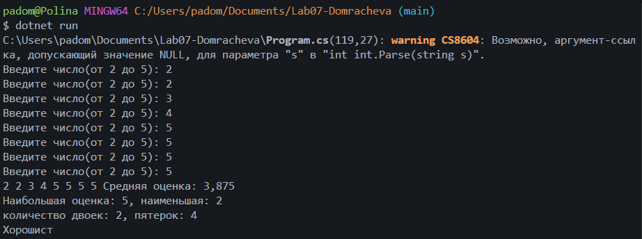
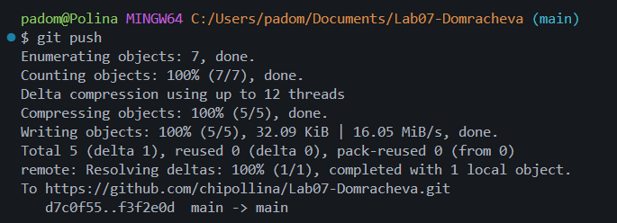

# Практическая работа №7 

**ФИО:Домрачевой Полины**  
**Группа:ИСП-241** 
**Дата:11.10.26** 

## Что изучено 

- Индекс массива начинается с нуля, последний элемент — `Length - 1`.
- Для изменения элементов нужен `for`, а `foreach` подходит только для чтения.
- Среднее, минимум/максимум, подсчёт по условию решаются одним проходом по массиву.

## Скриншоты

